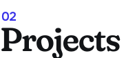

<picture>
  <source media="(prefers-color-scheme: dark)" srcset="assets/banner-dark.svg">
  <source media="(prefers-color-scheme: light)" srcset="assets/banner-light.svg">
  
</picture>

<br>

<picture>
  <source media="(prefers-color-scheme: dark)" srcset="assets/h01-dark.svg">
  
</picture>

Hi, I'm **Joms**, a software engineer in Manila building full-stack web apps and speech AI.

- building **[tinig labs](https://tiniglabs.digital)**: open Filipino speech AI, starting with atypical speech that mainstream models miss
- led **Cleft2Speech**: speech practice with IPA-level feedback and voice cloning for people with cleft lip and palate
- CS student, graduating Feb 2027

<br>

<picture>
  <source media="(prefers-color-scheme: dark)" srcset="assets/h02-dark.svg">
  
</picture>

<table>
  <tr>
    <td width="33%" valign="top">
      <sub>01</sub>
      <h4><a href="https://github.com/jomzxc/boardly">Boardly</a></h4>
      A neobrutalist Kanban board with real-time sync.
      <br><br>
      <code>next.js</code> <code>supabase</code>
      <br><br>
      <a href="https://boardly.jomszxc.tech">live ↗</a>
    </td>
    <td width="33%" valign="top">
      <sub>02</sub>
      <h4><a href="https://github.com/jomzxc/WebDrop">WebDrop</a></h4>
      Peer-to-peer file sharing in the browser over encrypted WebRTC.
      <br><br>
      <code>next.js</code> <code>webrtc</code>
      <br><br>
      <a href="https://webdrop.jomszxc.tech">live ↗</a>
    </td>
    <td width="33%" valign="top">
      <sub>03</sub>
      <h4><a href="https://github.com/jomzxc/Alkansya">Alkansya</a></h4>
      A personal finance and savings tracker.
      <br><br>
      <code>next.js</code> <code>postgres</code>
      <br><br>
      <a href="https://alkansya.jomszxc.tech">live ↗</a>
    </td>
  </tr>
</table>

<br>

<picture>
  <source media="(prefers-color-scheme: dark)" srcset="assets/h03-dark.svg">
  
</picture>

```
lang      python · typescript · javascript · java
ai        pytorch · nvidia nemo · asr · tts · voice cloning
web       next.js · django · fastapi
cloud     gcp · azure · vercel · docker
```

<br>

<picture>
  <source media="(prefers-color-scheme: dark)" srcset="assets/h04-dark.svg">
  
</picture>

<picture>
  <source media="(prefers-color-scheme: dark)" srcset="metrics-dark.svg">
  <source media="(prefers-color-scheme: light)" srcset="metrics-light.svg">
  
</picture>

<br>

<picture>
  <source media="(prefers-color-scheme: dark)" srcset="assets/h05-dark.svg">
  
</picture>

<!-- RECENT:START -->
<table><tr><td width="50%" valign="top">

**pull requests**

- `open` [Brand refresh: speech corpus logo, redesign and /brand guide](https://github.com/tinig-labs/collect.tiniglabs.digital/pull/2) <sub>tinig-labs/collect.tiniglabs.digital</sub>
- `open` [Brand refresh: notebook logo, redesign and /brand guide](https://github.com/tinig-labs/notebook.tiniglabs.digital/pull/2) <sub>tinig-labs/notebook.tiniglabs.digital</sub>
- `open` [Brand refresh: new tinig labs logo family, redesign and /brand guide](https://github.com/tinig-labs/tiniglabs.digital/pull/4) <sub>tinig-labs/tiniglabs.digital</sub>
- `merged` [Fix multi-user security issues and add a staging environment](https://github.com/tinig-labs/notebook.tiniglabs.digital/pull/1) <sub>tinig-labs/notebook.tiniglabs.digital</sub>
- `merged` [Announce the notebook closed beta and add it across the site](https://github.com/tinig-labs/tiniglabs.digital/pull/3) <sub>tinig-labs/tiniglabs.digital</sub>
- `merged` [Let search engines index the public pages, with correct canonicals](https://github.com/tinig-labs/collect.tiniglabs.digital/pull/1) <sub>tinig-labs/collect.tiniglabs.digital</sub>

</td><td width="50%" valign="top">

**commits**

- `0ade74d` [Add a staging environment](https://github.com/tinig-labs/notebook.tiniglabs.digital/commit/0ade74d6bc34112f737db835a23de33863a8ae4e) <sub>tinig-labs/notebook.tiniglabs.digital</sub>
- `295061b` [Fix multi-user security issues: shared devices, transcribe c](https://github.com/tinig-labs/notebook.tiniglabs.digital/commit/295061b4d7747e2bbb62337b37c5b9c0ac447edf) <sub>tinig-labs/notebook.tiniglabs.digital</sub>
- `f33a10d` [Add the organization profile README](https://github.com/tinig-labs/.github/commit/f33a10dda6781e0319754e8a873741ce16521d0c) <sub>tinig-labs/.github</sub>
- `60c8173` [Use the self-narrated cut of the notebook promo](https://github.com/tinig-labs/tiniglabs.digital/commit/60c81734324de5a34b497263b167f67f2bd56529) <sub>tinig-labs/tiniglabs.digital</sub>
- `151cdb3` [Announce the notebook closed beta and add it across the site](https://github.com/tinig-labs/tiniglabs.digital/commit/151cdb324cb5c5ee243ebd5280d9c44de39d735d) <sub>tinig-labs/tiniglabs.digital</sub>
- `e114783` [Add README, CONTRIBUTING and LICENSING in the tinig labs for](https://github.com/tinig-labs/notebook.tiniglabs.digital/commit/e114783e24fec19ddfa4d3c282c533f76b59dc32) <sub>tinig-labs/notebook.tiniglabs.digital</sub>

</td></tr></table>
<!-- RECENT:END -->

<br>

<picture>
  <source media="(prefers-color-scheme: dark)" srcset="assets/h06-dark.svg">
  
</picture>

<picture>
  <source media="(prefers-color-scheme: dark)" srcset="https://raw.githubusercontent.com/jomzxc/jomzxc/output/snake-dark.svg">
  <source media="(prefers-color-scheme: light)" srcset="https://raw.githubusercontent.com/jomzxc/jomzxc/output/snake-light.svg">
  
</picture>

<br>

<p align="center">
  <a href="https://tiniglabs.digital"><code>tiniglabs.digital</code></a>
  &nbsp;·&nbsp;
  <a href="https://jssabater.online"><code>jssabater.online</code></a>
  &nbsp;·&nbsp;
  <a href="https://www.linkedin.com/in/jomszxc"><code>linkedin</code></a>
</p>

<p align="center"><sub>— made in manila, mostly after midnight —</sub></p>
