<picture>
  <source media="(prefers-color-scheme: dark)" srcset="assets/banner-dark.svg">
  <source media="(prefers-color-scheme: light)" srcset="assets/banner-light.svg">
  
</picture>

<br>

<picture>
  <source media="(prefers-color-scheme: dark)" srcset="assets/h01-dark.svg">
  
</picture>

Hi, I'm **Joms**, a software engineer in Manila building full-stack web apps and speech AI.

- building **[tinig labs](https://tiniglabs.digital)**: open Filipino speech AI, starting with atypical speech that mainstream models miss
- led **Cleft2Speech**: speech practice with IPA-level feedback and voice cloning for people with cleft lip and palate
- CS student, graduating Feb 2027

<br>

<picture>
  <source media="(prefers-color-scheme: dark)" srcset="assets/h02-dark.svg">
  
</picture>

<table>
  <tr>
    <td width="33%" valign="top">
      <sub>01</sub>
      <h4><a href="https://github.com/jomzxc/boardly">Boardly</a></h4>
      A neobrutalist Kanban board with real-time sync.
      <br><br>
      <code>next.js</code> <code>supabase</code>
      <br><br>
      <a href="https://boardly.jomszxc.tech">live ↗</a>
    </td>
    <td width="33%" valign="top">
      <sub>02</sub>
      <h4><a href="https://github.com/jomzxc/WebDrop">WebDrop</a></h4>
      Peer-to-peer file sharing in the browser over encrypted WebRTC.
      <br><br>
      <code>next.js</code> <code>webrtc</code>
      <br><br>
      <a href="https://webdrop.jomszxc.tech">live ↗</a>
    </td>
    <td width="33%" valign="top">
      <sub>03</sub>
      <h4><a href="https://github.com/jomzxc/Alkansya">Alkansya</a></h4>
      A personal finance and savings tracker.
      <br><br>
      <code>next.js</code> <code>postgres</code>
      <br><br>
      <a href="https://alkansya.jomszxc.tech">live ↗</a>
    </td>
  </tr>
</table>

<br>

<picture>
  <source media="(prefers-color-scheme: dark)" srcset="assets/h03-dark.svg">
  
</picture>

```
lang      python · typescript · javascript · java
ai        pytorch · nvidia nemo · asr · tts · voice cloning
web       next.js · django · fastapi
cloud     gcp · azure · vercel · docker
```

<br>

<picture>
  <source media="(prefers-color-scheme: dark)" srcset="assets/h04-dark.svg">
  
</picture>

<picture>
  <source media="(prefers-color-scheme: dark)" srcset="metrics-dark.svg">
  <source media="(prefers-color-scheme: light)" srcset="metrics-light.svg">
  
</picture>

<br>

<picture>
  <source media="(prefers-color-scheme: dark)" srcset="assets/h05-dark.svg">
  
</picture>

<!-- RECENT:START -->
<table><tr><td width="50%" valign="top">

**pull requests**

- `merged` [Label the TORGO transfer charts and stop posts overflowing on phones](https://github.com/tinig-labs/tiniglabs.digital/pull/8) <sub>tinig-labs/tiniglabs.digital</sub>
- `merged` [Use the full width of wide screens in blog posts](https://github.com/tinig-labs/tiniglabs.digital/pull/7) <sub>tinig-labs/tiniglabs.digital</sub>
- `merged` [Publish the Zero-shot TORGO research report](https://github.com/tinig-labs/tiniglabs.digital/pull/6) <sub>tinig-labs/tiniglabs.digital</sub>
- `open` [tl: Add initial support for Tagalog](https://github.com/espeak-ng/espeak-ng/pull/2713) <sub>espeak-ng/espeak-ng</sub>
- `merged` [Cut GPU idle time and stop idle tabs from waking the database](https://github.com/tinig-labs/notebook.tiniglabs.digital/pull/8) <sub>tinig-labs/notebook.tiniglabs.digital</sub>
- `merged` [Remove the staging environment](https://github.com/tinig-labs/notebook.tiniglabs.digital/pull/7) <sub>tinig-labs/notebook.tiniglabs.digital</sub>

</td><td width="50%" valign="top">

**commits**

- `850dfd9` [Label each transfer chart and stop posts overflowing on phon](https://github.com/tinig-labs/tiniglabs.digital/commit/850dfd936649399f2b6a3709688ef9ad00868796) <sub>tinig-labs/tiniglabs.digital</sub>
- `ca5d131` [Align blog posts with the header width](https://github.com/tinig-labs/tiniglabs.digital/commit/ca5d1313c217953442c56a542530998677ef887f) <sub>tinig-labs/tiniglabs.digital</sub>
- `b07ece0` [Limit the wide layout to the blog posts](https://github.com/tinig-labs/tiniglabs.digital/commit/b07ece0c84ae3b0747412695f9327b4e621f3598) <sub>tinig-labs/tiniglabs.digital</sub>
- `ffd0aab` [Use the full width of laptop and desktop screens](https://github.com/tinig-labs/tiniglabs.digital/commit/ffd0aab311e480447ea38ba1d9e3fc81fc9f306b) <sub>tinig-labs/tiniglabs.digital</sub>
- `cf74322` [Credit the Zero-shot TORGO post to Jommel Rowin Sabater](https://github.com/tinig-labs/tiniglabs.digital/commit/cf743229a582f369e1d8d794112a1661f497b376) <sub>tinig-labs/tiniglabs.digital</sub>
- `3cba992` [Update the listener's verdict: F03's clone sounds like F03 t](https://github.com/tinig-labs/tiniglabs.digital/commit/3cba9924e476a20000cbcf68d7682c4d6d324ae2) <sub>tinig-labs/tiniglabs.digital</sub>

</td></tr></table>
<!-- RECENT:END -->

<br>

<picture>
  <source media="(prefers-color-scheme: dark)" srcset="assets/h06-dark.svg">
  
</picture>

<picture>
  <source media="(prefers-color-scheme: dark)" srcset="https://raw.githubusercontent.com/jomzxc/jomzxc/output/snake-dark.svg">
  <source media="(prefers-color-scheme: light)" srcset="https://raw.githubusercontent.com/jomzxc/jomzxc/output/snake-light.svg">
  
</picture>

<br>

<p align="center">
  <a href="https://tiniglabs.digital"><code>tiniglabs.digital</code></a>
  &nbsp;·&nbsp;
  <a href="https://jssabater.online"><code>jssabater.online</code></a>
  &nbsp;·&nbsp;
  <a href="https://www.linkedin.com/in/jomszxc"><code>linkedin</code></a>
</p>

<p align="center"><sub>— made in manila, mostly after midnight —</sub></p>
